<div align="center">

&nbsp;&nbsp;&nbsp;

<h1>asg</h1>


<br>

[](https://github.com/kxngHADES/asg-harness/actions/workflows/ci.yml)
[](https://github.com/kxngHADES/asg-harness/releases/latest)
[](go.mod)


</div>

<br>

<p align="center">
  
</p>

<br>

ASG is a coding agent for the terminal, with a browser version on the side. It works with
[Ollama](https://ollama.com) out of the box and switches to Anthropic, OpenAI, OpenRouter, Groq,
LM Studio or anything OpenAI-compatible with one flag. It reads your code, runs commands, edits
files, and stops to ask before anything that changes your machine.

It's built to get real work out of small local models. A loop harness breaks a task into steps,
gives the model a fresh short context for each one, has every step checked, and runs your tests
before calling it done.

## Install

```sh
# macOS / Linux
curl -fsSL https://raw.githubusercontent.com/kxngHADES/asg-harness/main/install.sh | sh

# Windows (PowerShell)
irm https://raw.githubusercontent.com/kxngHADES/asg-harness/main/install.ps1 | iex

# anywhere with Go
go install github.com/kxngHADES/asg-harness/cmd/asg@latest
```

For local models you need [Ollama](https://ollama.com/download) and a model, e.g. `ollama pull qwen3.5:9b`.
For hosted models, an API key is enough. `asg update` upgrades in place.

<details>
<summary>Install options and building from source</summary>

<br>

The shell script picks your OS and CPU, checks the SHA-256 checksum and installs to `/usr/local/bin`
(or `~/.local/bin`, printing the `PATH` line to add if needed). `ASG_VERSION=v0.2.0` pins a release and
`ASG_INSTALL_DIR=~/bin` picks the folder. On Windows it goes to `%LOCALAPPDATA%\Programs\asg` and
onto your user `PATH`.

```sh
git clone https://github.com/kxngHADES/asg-harness && cd asg-harness
make install        # builds to ~/.local/bin/asg
```

</details>

## Use it

```sh
cd your-project
asg
```

Ask for something. When ASG wants to run a command or change a file it shows a gate: <kbd>y</kbd> runs it,
<kbd>a</kbd> always allows that kind of call in this project, <kbd>g</kbd> allows it everywhere, <kbd>n</kbd> blocks it.
Run `/init` once and ASG writes an `ASG.md` about your project so later sessions start informed.

| Key | |
|---|---|
| <kbd>/</kbd> | command menu, filtered as you type |
| <kbd>Shift</kbd> <kbd>Tab</kbd> | cycle mode: build, plan, loop, ask |
| <kbd>Ctrl</kbd> <kbd>T</kbd> | cycle domain: software, docs, cyber, devops, pm |
| <kbd>Ctrl</kbd> <kbd>Y</kbd> | YOLO: run tools without asking, until you press it again |
| <kbd>Ctrl</kbd> <kbd>V</kbd> | paste a screenshot |
| <kbd>Ctrl</kbd> <kbd>J</kbd> | new line |
| <kbd>Ctrl</kbd> <kbd>C</kbd> | stop the current turn, twice to quit |

Outside the interactive shell:

```sh
asg -p "summarise this repo in 5 bullets"           # one answer, plain output
git diff | asg -p -                                 # "-" reads the prompt from stdin
asg -loop -yolo -p "add a --json flag, with tests"  # unattended; exit code 2 if it didn't finish
asg -provider anthropic -model claude-opus-5-5      # switch backend (remembered)
asg dashboard                                       # the browser version on 127.0.0.1:7777
```

The [terminal guide](docs/README.md) goes through every key and command with examples.

## What's in it

**Modes.** *build* makes changes. *plan* only reads and hands back a numbered plan. *ask* answers
questions from the actual files. *loop* treats each message as an objective for the loop harness.
Plan and ask are never given a tool that can change your project.

**Domains.** The kind of work changes the workflow the model follows. *software/work* only allows code
the current build uses and ends with a security pass. *docs* screenshots the rendered page after every
edit. *cyber* (red or blue) confirms scope first and ends with a full report. *devops* reviews pipelines
and infra. *pm* plans, estimates and tracks risk. See [domains](docs/domains.md).

**Loop harness.** `/loop <objective>` runs this, and the harness decides what happens next, not the model:

```
PLAN ──► WORK on one step ──► REVIEW ──► next step ─┐
            ▲                   │                   │
            └── retry / split ──┘                   ▼
                              VERIFY (your tests) ──► FINAL STEPS ──► REVIEW ×4
```

Runs are saved after every step, so `/loop resume` picks up after a restart, a question or <kbd>Ctrl</kbd> <kbd>C</kbd>.
Details in [docs/loop.md](docs/loop.md).

**Self-review.** After every answer ASG goes back over its work at least four times, each from a
different angle, and fixes what it finds (`/review` to change that). If the model is missing something only you know, it stops and asks.

**Images and voice.** Paste or drag in screenshots. Replies can be read aloud by the model itself, an
Ollama speech model, OpenAI TTS, or your OS voice.

**Memory and skills.** Notes it should keep go to `~/.asg/memory/` as plain Markdown. `SKILL.md` skills
install from GitHub, a URL or a folder with `asg skill add`.

**Tools.** Shell, files, glob, grep, web fetch, Word/PowerPoint/Excel output, browser screenshots,
and your own script tools in any language (`asg tool new <name>`).

**Work folder.** In build and loop runs ASG keeps `plan.md`, `checklist.md`, `walkthrough.md` and a
full `activity.md` log in `.asg/work/`, so you can see exactly what it did.

<details>
<summary><b>Commands</b></summary>

<br>

| Command | |
|---|---|
| `/mode`, `/domain` | pick a mode or domain from a menu |
| `/plan`, `/build`, `/ask` `[text]` | switch mode and send |
| `/software`, `/docs`, `/cyber`, `/devops`, `/pm` `[flavor] [text]` | switch domain and send |
| `/loop …` | start, `status`, `resume`, `verify <cmd>` |
| `/provider`, `/model`, `/models` | change backend or model |
| `/init` | write or improve `ASG.md` |
| `/memory`, `/permissions` | browse notes, revoke "always allow" rules |
| `/image <path>`, `/paste` | attach an image |
| `/voice …`, `/speak` | voice output |
| `/skills`, `/skill add\|rm\|show`, `/<skill> <request>` | skills |
| `/tools`, `/tool new <name>` | list or scaffold tools |
| `/review`, `/work`, `/yolo`, `/dashboard`, `/clear`, `/usage`, `/config`, `/exit` | |

All of them, with arguments: [docs/commands.md](docs/commands.md).

</details>

<details>
<summary><b>Config</b></summary>

<br>

Everything lives in `~/.asg/config.json` (move it with `ASG_HOME`), and the dashboard edits the same file.

```json
{
  "active_provider": "ollama",
  "providers": {
    "ollama":    { "type": "ollama",    "base_url": "http://localhost:11434",    "model": "qwen3.5:9b", "num_ctx": 16384 },
    "anthropic": { "type": "anthropic", "base_url": "https://api.anthropic.com", "api_key": "sk-ant-…", "model": "claude-sonnet-5-5" },
    "openai":    { "type": "openai",    "base_url": "https://api.openai.com/v1", "api_key": "sk-…",     "model": "gpt-5" }
  },
  "loop":   { "max_iterations": 30, "step_attempts": 3, "verify": "" },
  "review": { "passes": 4, "max_passes": 6 },
  "domain": "software", "flavor": "work"
}
```

There is no limit on how many tools the model uses in one turn; it keeps going until it's done or you press Ctrl+C. Set `"max_tool_rounds": N` only if you want a cap. If a model rejects tool definitions, ASG switches to chat-only mode for it automatically.

`num_ctx` is the Ollama context window: unset means 16384, because Ollama's own default quietly cuts off long prompts, and a negative value leaves Ollama's default. Lower it if a model no longer fits in VRAM; raise it for long files.

`NO_COLOR=1`, `ASG_NO_ANIMATION=1` and `ASG_DEBUG=asg.log` do what they say. More in
[docs/cli-and-config.md](docs/cli-and-config.md).

</details>

<details>
<summary><b>Security</b></summary>

<br>

- Shell, file writes, web fetch, document and screenshot tools all go through the gate. Shell rules match
  the program, so allowing `git status` covers `git log`, but `git status && rm -rf build` still asks about
  `rm`. Anything with `$(…)` or backticks always asks.
- YOLO only lasts until you turn it off or quit.
- The dashboard binds to 127.0.0.1, needs a per-run token on every request, rejects non-local `Host`
  headers and masks API keys before they reach the browser.
- Releases and `asg update` are checked against `checksums.txt`.

</details>

## Development

```sh
make test    # go test ./...
make lint    # gofmt + go vet
make run     # build and start
```

[ASG.md](ASG.md) covers the layout and conventions. The terminal UI is built on
[Charm](https://charm.land/#libs) (Bubble Tea, Bubbles, Lip Gloss, Huh, Glamour, Log, Harmonica);
read [AGENTS.md](AGENTS.md) before changing it.

Commits follow [Conventional Commits](https://www.conventionalcommits.org/). Merging to `main` updates a
release PR, and merging that tags a version and publishes binaries for macOS, Linux and Windows.

<br>

<p align="center"><sub>The crab is drawn with half-block characters and lives in <code>internal/sprite</code>.</sub></p>
